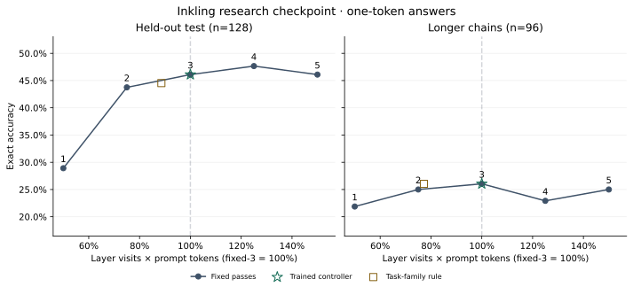

# Inkling 循环预算：M1 实验结果

2026-11-23 · 单张 H20 · `TML-d24-varloop-research` · `IQ4_NL`

**结论：按输入分配循环次数值得继续研究；这版逐题分类器未达到推进门槛。** 我们训练了五个分类头，用题目文本估计各圈答对的概率。验证集最终退回固定 3 圈。同一批数据上，只按题族估计正确率的简单策略能减少层调用，但在常规测试上丢了两道题，长输入测试整体准确率也接近四选一的随机基线。

## 留出结果

| 策略 | 常规测试（128 题） | 长输入测试（96 题） | 常规 / 长输入层调用量节省 |
|---|---:|---:|---:|
| 固定 1 圈 | 28.91% | 21.88% | 50% / 50% |
| 固定 2 圈 | 43.75% | 25.00% | 25% / 25% |
| 固定 3 圈 | 46.09% | 26.04% | 基准 |
| 固定 4 圈 | 47.66% | 22.92% | −25% / −25% |
| 固定 5 圈 | 46.09% | 25.00% | −50% / −50% |
| 逐题分类器（验证集选固定 3 圈） | 46.09% | 26.04% | 0% / 0% |
| 题族均值策略 | 44.53% | 26.04% | **11.41% / 22.77%** |
| 事后 oracle | 53.12% | 29.17% | 41.33% / 46.78% |

oracle 看得到每题在五个圈数上的真实判分：答对就挑成本最低的圈数；五档全错时挑 1 圈。它描述这批题上的理论空间，不是可部署策略。层调用量按 `(12 + 12 × 圈数) × 提示 token 数` 计，不等于 FLOPs、实际速度或吞吐。原始延迟来自同一档位下的四并发扫圈，受共享 GPU、排队和批处理影响。

## 哪些题变好了，哪些题退步了

- 题族策略在常规测试将 **2 道固定 3 圈能做对的算式**改错，没有找回其他题；准确率差 −1.56 个百分点，分层配对 bootstrap 95% 区间约 [−3.91, 0.00] 个百分点。长输入测试中逐题正确性没有变化；这不意味着新输入不会退化。
- 增加计算也不保证答对。常规测试从 3 圈加到 4 圈，找回 5 题，也改错 3 题。算式 `23cd539d20ebc0e884e9` 的答案序列是 **A、A、D、A、A**，真值 D，只有 3 圈答对。训练停止策略时应允许这种非单调结果。
- 留一题族诊断中，训练与选参都没见过最短路或程序追踪时，学出的策略在各自常规测试均比固定 3 圈低 **12.5 个百分点**（各 32 题）。算式和表格两个折选回固定 3 圈。现有数据不能支撑未见题型的泛化主张。
- 长输入分区上固定 3 圈仅答对 25/96，随机选项的期望是 24/96。题族策略省掉的计算，有一部分来自模型多算也没答对的题；不能把这部分结果解读为高质量回答的加速。

## 实验和交付

固定同一份 GGUF 和答题模板，五档对每个 token 分别执行 24、36、48、60、72 次层调用。共使用 608 道程序生成、独立解法复核的英文单选题：训练 288、选参 96、常规测试 128、长输入测试 96。每档先验证四道答案位置不同的简单题，再做贪心单 token 输出，合计 **3,040 条正式推理记录**。首次尝试缺少 assistant 答案前缀，输出坍缩，整批作废；正式跑的五档共 20 个格式阳性对照全部通过。

预设门槛：常规与长输入两组都应节省至少 10% 层调用量，且准确率差的配对区间下界不低于 −5 个百分点。逐题方案的节省为 0%，因此未通过。题族方案达到本次探索的数值门槛，但只验证了有限的合成模板，且长输入绝对准确率低，不建议据此上线。

可复现材料：[项目说明](README.md)、[实验协议](PROTOCOL.md)、[后端构建说明](BACKEND.md)、[评测明细](evidence/metrics.json)、[逐题决策](evidence/decisions.json)、[扫描证据](evidence/run-evidence.json)、[留一题族诊断](evidence/transfer.json)。两份权重重新载入后，均验证了全部 608 道题的选圈决策。

**下一步优先更换训练信号。** 冻结基座，在第一圈已经计算出的状态上训练一个小停止头，估计继续循环能否提高答对概率。保持题族策略作对照，先换一组绝对准确率足够高、可以判分的任务，再验证是否能在陌生模板上超过简单规则。进入逐 token 停止之前，还需要单独验证各圈 KV 的使用和实际端到端成本。
