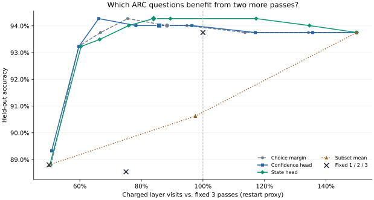

# Inkling Loop Budget

[简体中文](README.zh-CN.md)

**Can a looped model tell when another two passes will help?** This project
trains small controllers on paired outputs from Thinking Machines Lab's
frozen [Inkling variable-loop research checkpoint](https://huggingface.co/thinkingmachines/TML-d24-varloop-research).
The controller can see the result of one pass, and estimates the change in
answer correctness if the model goes to three passes.

The supervision keeps the sign of that change. A **wrong → right** change is
+1, a **right → wrong** change is −1, and no change in correctness is 0.
The experiment checks whether the first-pass hidden state adds anything over
the first-pass answer margin or a confidence-only model.

On 384 held-out ARC questions, the state head answered **362 correctly**
vs. **360** for fixed three passes, with **16.04% fewer charged layer visits**
in restart replay. The confidence-only head reached **361 correct** with
**14.24% fewer visits**. The small difference between the learned heads is
not conclusive.



[Results and limitations](m2/RESULTS.md) ·
[Evaluation protocol](m2/PROTOCOL.md) ·
[Rebuild the GPU experiment](m2/REPRODUCE.md)

## Replay on CPU

Use Python 3.11 or 3.12. The replay uses recorded model outputs; no model
download, GPU, API key, or external inference service is needed.

```bash
python -m venv .venv
# Activate the environment, then:
python -m pip install -r requirements.txt
python verify_release.py
```

To fit and inspect the M2 heads directly:

```bash
python m2/fit.py m2/evidence/paired.jsonl.gz work/m2
```

`m2/route.py` applies a released head to a JSON record containing four A–D
logits (`logits`), the rendered prompt token count (`tokens`), and the
96-component projection (`state`, required only by the state head). It emits
an estimated gain and a pass count. The checked-in evidence and model
coefficients are ordinary data files; replay does not execute a pickle.

## Scope

- **M2**: 1,088 ARC Easy/Challenge questions with official train, validation
  and test separation; fixed 1/2/3 passes, four routing baselines and a
  gold-informed oracle. Native collection runs on llama.cpp; CPU replay trains
  and validates the small heads.
- **M1**: the [initial synthetic study](M1-results.md) with 608 questions and
  five pass counts. It tested picking depth before the model ran.

This is an **offline research release**. The native probe collects fixed-depth
outputs; it does not skip layers inside a running request. Costs are prompt
tokens multiplied by layer visits. The restart and hypothetical reuse proxies
do not measure latency or throughput. Results are specific to the pinned
quantization and short, constrained multiple-choice prompts.

Project code is [MIT licensed](LICENSE). See [sources and data terms](THIRD_PARTY.md)
for the weights, public benchmark and native backend. No base weights are bundled.
