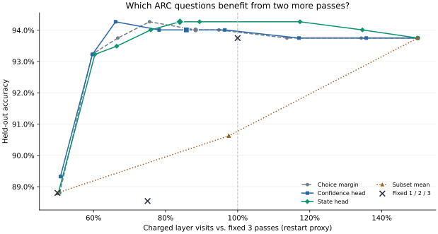

# First-pass stopping on ARC

The hidden-state stopping head answered **362 of 384** held-out ARC
questions correctly (94.27%). Always running three passes answered
**360 of 384** (93.75%). In a replay that charges for the full three-pass
restart on upgraded questions, the head used **16.04% fewer layer visits**
than fixed three passes. The paired 95% bootstrap interval on the accuracy
difference was **−0.78 to +1.82 percentage points**.

| Held-out policy | Correct / 384 | Accuracy | Rescued / 25 | Work saved vs. fixed 3 |
| --- | ---: | ---: | ---: | ---: |
| Fixed 1 pass | 341 | 88.80% | 0 | 50.00% |
| Fixed 2 passes | 340 | 88.54% | — | 25.00% |
| Fixed 3 passes | 360 | 93.75% | 25 | 0.00% |
| ARC subset mean | 341 | 88.80% | 0 | 50.00% |
| First-pass choice margin | 361 | 94.01% | 25 | 11.66% |
| Learned confidence head | 361 | 94.01% | 25 | 14.24% |
| Learned state head | 362 | 94.27% | 22 | **16.04%** |
| Gold-informed oracle | 366 | 95.31% | 25 | 43.66% |

“Rescued” counts how many of the 25 wrong-at-one, right-at-three questions
were upgraded by a 1→3 policy. Fixed two passes is a different decision with
its own outputs; it does not attempt a 1→3 rescue. Adaptive rows use the
predeclared 40% validation token cap, with no threshold chosen on the test
set. Subset means produce exact score ties; the entire top group exceeded
the validation cap, so this baseline admitted no requests at that budget.
The oracle uses the correct answer after both passes and is not deployable.

Of 384 held-out questions, 25 went wrong→right and 6 went right→wrong when
changing from one pass to three. The state head missed three rescues but
kept five previously correct answers that a fixed three-pass policy would
have changed to wrong. Both learned heads and the simple margin met the
predeclared replay gate (at least 10% work savings, accuracy difference
interval lower bound at least −5 points).

## Does the hidden state help?

At the primary operating point the state head used 1.80 percentage points
less work than the learned confidence head, and answered one more question
correctly. Across paired answers, that net +1 consisted of four gains and
three losses. The corresponding 95% interval was **−1.04 to +1.56 points**.
The advantage is small and inconclusive. Confidence alone matched or
exceeded the state head at some other budgets; it is the stronger default
starting point for a follow-up implementation.

At the same primary setting, the state head answered 174/192 Challenge
questions (three losses and three gains vs. fixed three) and 188/192 Easy
questions (two gains and no losses). Its restart-proxy work savings were
13.67% and 18.65% in the two subsets, respectively.

## What was actually run?

A single H20 ran the pinned IQ4_NL checkpoint for 1,088 ARC questions at
each of one, two and three passes, **3,264 benchmark evaluations** plus
12 format checks. The official splits contribute 512 examples for fitting,
192 for budget selection and 384 for held-out evaluation. Only 39 training
examples changed correctness between one and three passes (30 repairs and
9 regressions). The paired intervals quantify sampling variation on this
benchmark mix; they do not capture training or backend variation.

The work proxy charges every real prompt token at 24, 36 or 48 layer visits.
Upgrading a request charges 24 + 48 visits per token in the restart model.
The probe's unused padding, host/device readout, routing overhead, and
model/worker scheduling are outside the proxy. There is no measured GPU
speedup and no live continuation or KV reuse implementation. The checkpoints
were not fine-tuned. Training set overlap with the base model is unknown,
and ARC does not establish transfer to unseen benchmarks, longer contexts,
open-ended answers or other quantizations.

[Evaluation protocol](PROTOCOL.md) · [Reproduction steps](REPRODUCE.md) ·
[Metrics](evidence/metrics.json) · [Head weights](evidence/heads.json) ·
[Per-question decisions](evidence/decisions.json) · [Run record](evidence/run.json)
